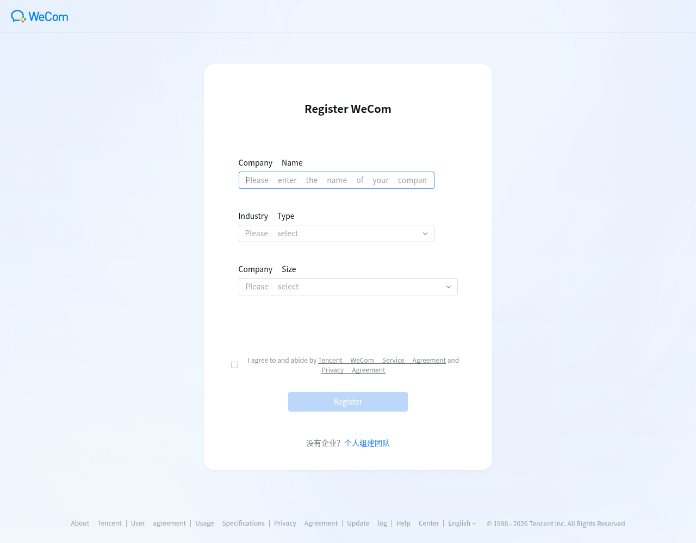

# WeCom Inbox

**先留存原件，再选择处理方式。**

一个可独立运行的企业微信业务收件箱：保存机器人实际收到的消息和附件，查找来源、下载原件、导出资料，再交给普通程序、知识库或 Agent 处理。**不需要 AI 账号，也不依赖某一种 Agent 框架。**

[English](README.md) · [接口说明](docs/api.md) · [部署与恢复](docs/deployment.md) · [实施及验证状态](docs/design.md)

> 当前是 v0.1.0 候选版，保持私有验收。自动化回归和本地浏览器检查已有覆盖；真实企业微信单聊、群聊 @、引用文件与媒体收件已验收，断线重连与真人独立上手仍待完成。本项目由社区独立维护，不属于腾讯官方产品。


网页收件箱预览；全部为明确标注的合成测试样例，不含客户数据。

## 能做什么

- 多机器人收件，按发送人或会话明确授权。
- 先持久记录消息，再下载附件；下载凭据临时加密保存，完成后清除。
- 一条消息的多个附件及引用文件分别保存，核对大小和 SHA-256；处理中断可恢复。
- 中英文网页收件箱，按内容、文件名、机器人、时间、发送人、类型和状态查找。
- JSON/CSV 导出，附件原件下载，分页 HTTP API。
- 多个处理程序各自订阅、重试和登记结果，互不覆盖处理状态。
- 可选择回复原会话；明确区分“已收件”“投递已确认”“业务处理完成”“发送结果不确定”。
- 只读导入旧 JSONL 资料，停机备份和恢复到新目录。

只保存平台实际推送给机器人的内容，不能据此读取任意个人微信、外部群或企业全量聊天。群聊需要按平台规则 @机器人。经真机验证的平台限制：语音只提供转写文字、不含录音；合并聊天记录不推送内容；过期文件引用拿不到原件；单个附件上限 50 MB。详见[验收记录](docs/design.md#真实平台验收记录2026-10-24)。

## 先选择你的使用方式

**这是同一套软件的两种使用方式，不需要下载两个不同程序。** 两种方式都不需要 AI 账号。

| 你现在的情况 | 使用方式 | 需要准备 |
|---|---|---|
| 有自己能管理的企业微信智能机器人 | [已有机器人：直接接入](#with-bot) | Bot ID、长连接 Secret、允许测试的成员或群聊范围 |
| 目前没有可用机器人，先体验软件 | [无机器人：离线体验](#without-bot) | 无需企业微信凭据；使用明确标注的样例或符合格式的历史资料 |
| 目前没有可用机器人，希望接收真实企微消息 | [无机器人：从零创建](#create-bot) | 能登录企业微信并创建智能机器人；没有权限时由企业管理员协助 |
| 连企业微信都还没有开通 | [从零开通企业微信](#register-wecom) | 手机、能正常使用的微信、可接收验证码的手机号、真实企业或组织信息 |

旧目录里存在机器人配置，不代表当前使用者拥有或可以操作它。实际接入以使用者确认的新配置为准。

<a id="register-wecom"></a>

## 第零步：从零开通企业微信

企业微信（WeCom）是腾讯的客户端；WeCom Inbox 是本项目的收件工具。这一步先创建企业微信里的企业/组织账号，再创建给收件工具使用的机器人。
**推荐用电脑打开官网，手机配合安装、扫码和身份验证。** 不需要先懂服务器、编程或 AI。

### 1. 准备好这些东西

- 自己能够操作的手机，以及可正常登录的微信。
- 能接收验证码的常用手机号；如果页面提供国家/地区选项，按真实区号选择。
- 真实企业或组织的名称、行业和人员规模。
- 注册页面后续要求的管理员资料或身份验证，由本人按实际提示完成。

手机号地区、主体类型和账号状态可能影响后续验证。下面给出能核对的入口，不承诺所有地区或账号都会出现完全相同的验证页面。

### 2. 打开官方网站，安装企业微信

电脑打开 **[企业微信官网](https://work.weixin.qq.com/)**，网址认准 `work.weixin.qq.com`。
海外或英文环境可能显示 **WeCom**，是这里同一产品的名称。

- 手机上从官网的 **下载 / Download** 入口选择 iOS 或 Android，按页面指引安装。
- 电脑端可按自己的 Windows 或 macOS 系统下载安装。
- 安装后先保留手机端，后面的扫码或验证按页面要求使用微信或企业微信完成。

### 3. 进入注册页面，填写企业信息

在官网选择 **立即注册 / Register Now**。也可打开[官方注册页](https://work.weixin.qq.com/wework_admin/register_wx?from=myhome)。
本次查看的空白注册页首先展示以下三项：

| 页面字段 | 英文显示 | 怎么填写 |
|---|---|---|
| 企业 / 组织名称 | Company Name | 填写你实际使用的企业或组织名称；后续如要求核验主体，再按真实证件信息核对 |
| 行业类型 | Industry Type | 选择与你的实际业务最接近的类别 |
| 人员规模 | Company Size | 按实际人数选择对应档位 |



截图来自官方公开注册页，未填写身份资料、未提交注册；页面语言、布局及后续验证可能随账号和版本变化。

### 4. 按页面提示完成本人验证和注册

阅读页面协议，确认同意后由本人提交注册。如果随后要求管理员姓名、手机号、短信验证码或微信扫码，
填写真实信息，并使用你本人长期控制的微信或企业微信完成对应验证。验证码只填在官方页面。

如果要求实名认证、企业主体资料或认证费用，先查看该步骤的具体用途和要求；不要把网上其他账号的流程直接套用到自己的账号。
目前未核实所有地区和主体的认证条件，因此不把“完全免认证”或“全程必需付费”写成统一要求。

注册页还有“个人组建团队”入口；本指引未验证这种类型能否在你的账号中使用所需的智能机器人 API，
不能把创建个人团队成功直接当作机器人能力已经开通。用于实际业务时，按真实主体选择入口。

### 5. 确认企业微信已经开通

在手机企业微信中登录，并确认能看到刚创建的企业/组织名称。
再从官网 **企业登录 / Login** 进入管理后台，按页面提示扫码，确认登录的是同一个企业。

本项目需要能够创建或管理智能机器人的权限。如果仅有普通成员权限，需由该企业的管理员代建或授权。
做到这里，你只需要确认 **企业已经创建、自己能进入正确的企业、能找到创建机器人的入口**。

### 6. 接着创建测试机器人

开通企业微信后，继续下面的[从零创建机器人](#create-bot)：选择 API 模式、使用长连接，
名称可用 `WeCom Inbox 测试助手`，可见范围先限于测试人员。取得 Bot ID 和 Secret 后，由部署人员接入收件箱。

### 遇到问题时怎么继续

| 卡住的位置 | 下一步 |
|---|---|
| 手机号不可选、收不到验证码 | 核对真实区号和页面支持的地区，记录具体错误提示；不要把验证码发给部署人员 |
| 只看到“加入企业” | 回到官网注册入口，区分创建自己的组织与加入已有组织；不要加入来源不明的邀请 |
| 只看到个人团队入口 | 先确认该类型是否具备所需管理后台和智能机器人权限，不默认与企业主体等价 |
| 找不到智能机器人 | 按腾讯官方说明检查客户端版本，并核对当前企业及权限；管理员可查看管理后台入口 |
| 出现实名、主体认证或付费要求 | 保留提示文字和当前步骤，再核对是否是使用目标功能所必需 |

企业微信内的账号验证需要本人完成；软件部署、配置检查、收件与附件核对由部署人员处理。
上述创建机器人入口另参考[腾讯官方指南](https://intl.cloud.tencent.com/zh/document/product/1316/84454)。

## 安装程序（两种方式共用）

需要 Linux/macOS 和 Go 1.26.4 或更新版本：

```sh
git clone https://github.com/iCookCloud/wecom-inbox.git
cd wecom-inbox
make build
./wecom-inbox init
./wecom-inbox check
./wecom-inbox serve
```

打开 `http://127.0.0.1:8787`，使用新生成的私有 `config.toml` 中的 `admin_token` 登录。初始化不会覆盖已有文件。

上面的命令先启动空收件箱，没有配置机器人时不会连接企业微信。需要接入真实消息时，再按下面的“已有机器人”说明配置。

<a id="with-bot"></a>

## 说明一：已有机器人，直接接入

### 1. 确认机器人类型和归属

打开你能管理的机器人详情，确认它是 **API 模式的智能机器人**，并选择 **使用长连接**。
需要能取得该机器人的 **Bot ID** 和 **Secret**。仅有群消息推送 Webhook 地址，不能直接填入本软件的长连接配置。

如果机器人正在连接其他网关，先安排好切换，或给 WeCom Inbox 单独创建一个测试机器人。
一个 Bot 不应同时交给两套网关连接；旧配置的本地备注也不一定等于企业微信里的显示名称。

### 2. 准备接入信息

| 信息 | 用途 | 由谁处理 |
|---|---|---|
| 企业微信里的机器人名称 | 方便找到真实聊天入口 | 使用者确认 |
| Bot ID | 标识要连接的机器人 | 使用者或企业管理员取得，部署人员配置 |
| Secret | 验证连接身份 | 写入服务器私有配置，不放进公开仓库、说明或截图 |
| 允许测试的成员 / 群聊 | 限定谁可以向收件箱交资料 | 使用者确定范围，部署人员核对平台 ID 并加入白名单 |

部署人员参照 `config.example.toml`，把以上信息加入私有 `config.toml`，设置 `enabled = true`；
需要收件回执时设置 `receipt = true`。保留初始化生成的随机管理员令牌，检查配置后启动服务。
有效配置会自动加载，随后在“连接与处理程序”里确认机器人状态为“已连接”。

### 3. 完成真实收发测试

1. 在企业微信里打开这个机器人的单聊，发送 `WeCom Inbox 测试`。
2. 再发送一张非敏感图片和一个小的 Excel、PDF 或 TXT 测试文件。
3. 在网页收件箱里核对文字、发送人、时间和附件；下载附件并核对原件。
4. 如需群聊接入，把机器人加入允许测试的群，再引用已发送的文件并 @机器人。
5. 启用了回执时核对客户端回执；配置了外部处理程序时，再分别检查投递、处理结果和可选回复。

“已连接”只说明连接建立；以上收发、附件和客户端显示都通过，才算完成真实平台验收。

<a id="without-bot"></a>

## 说明二：目前没有机器人

### A. 先体验软件，不创建机器人

可以先使用空收件箱，或在独立资料目录中导入样例/符合格式的历史 JSONL。此时不需要 Bot ID、Secret，也不需要 AI 账号。

| 功能 | 无机器人时能否使用 |
|---|---|
| 打开网页收件箱 | 可以 |
| 查询、筛选、下载和导出已导入的资料 | 可以 |
| 通过 HTTP API 读取资料、登记处理结果 | 可以，仍需访问令牌 |
| 自动接收企业微信的新消息、图片和文件 | 不可以，需先创建并连接机器人 |
| 回复到企业微信会话 | 不可以 |
| 网页拖拽上传任意文件 | 当前版本未实现；离线导入入口是命令行 JSONL 导入 |

源码目录中可按以下步骤体验，数据放在源码目录外，避免混入现有收件箱或提交到 Git：

```sh
mkdir -p ../wecom-inbox-demo
./wecom-inbox init -c ../wecom-inbox-demo/config.toml
./wecom-inbox import -c ../wecom-inbox-demo/config.toml \
  --file tests/fixtures/legacy/messages.jsonl \
  --media-root tests/fixtures/legacy
```

样例均为合成测试数据，预期导入 4 条记录、其中 1 个附件故意缺失。导入命令会显示失败记录并返回退出码 1，
这不是企业微信连接故障。查看结果后，再单独运行：

```sh
./wecom-inbox serve -c ../wecom-inbox-demo/config.toml
```

打开 `http://127.0.0.1:8787`，使用这份演示配置里的 `admin_token` 登录。若已有服务占用此地址，
先把演示配置的 `listen` 改成另一个本机端口。离线导入不会自动触发 Webhook 或发送企微回复；
这套体验也不能替代真实平台验收。

<a id="create-bot"></a>

### B. 从零创建机器人，接收真实企业微信消息

1. **准备企业微信账号与权限。** 能登录企业微信，并能创建智能机器人；还没有开通时，先按
   [第零步：从零开通企业微信](#register-wecom) 操作。入口或权限不可用时，请企业管理员协助。
2. **打开创建入口。** 客户端可从“工作台 → 智能机器人 → 创建 → 手动创建”进入；
   管理员也可从管理后台的“安全与管理 → 管理工具 → 智能机器人”进入。
3. **选择 API 模式。** 在创建页面底部选择“API 模式创建”，连接方式选择“使用长连接”。
4. **填写机器人信息。** 名称可以用 `WeCom Inbox 测试助手`，可见范围先限于参与测试的人。
5. **取得并保存凭据。** 记录 Bot ID，取得 Secret 后妥善保存，再完成机器人创建。
6. **接入本软件。** 按上面的“已有机器人”说明，由部署人员配置连接和成员/群聊白名单，然后做真实收发测试。

创建入口与长连接配置依据腾讯官方说明核对：[企业微信智能机器人接入指南](https://intl.cloud.tencent.com/zh/document/product/1316/84454)
与[管理后台创建指引](https://cloud.tencent.com/document/product/1689/128999)。这里只使用它们的机器人创建步骤；
使用 WeCom Inbox 不需要安装 CodeBuddy、OpenClaw 或购买它们的服务。

### 谁需要做什么

- **使用者 / 企业管理员**：登录企业微信、创建或确认可用机器人、确定可见范围和测试成员、发送测试资料并查看客户端回复。
- **部署人员**：安装 WeCom Inbox、把凭据放入私有配置、设置白名单、检查后台收件与文件完整性、配置需要的外部处理程序。
- **GitHub 操作**：与机器人创建分开。没有机器人也能查看代码和体验软件；真实收件验收尚未通过时，不宣称企微接入已经验收完成。

## 与现有系统互补

独立处理程序通过 HTTP API 或签名 Webhook 获取资料，通过结果接口登记处理情况。不同程序有不同令牌、Bot 范围和回复权限；不需要获得机器人 Secret。

仓库中的 Python 示例使用标准库验证附件哈希并登记结果，不调用模型。自研 Agent 可基于同一接口增加适配；本版不声称已经兼容尚未联调的专有协议。

## 数据与运维

`data/` 保存数据库、原附件、恢复清单和临时下载凭据的加密密钥。附件和完成的消息不是静态加密资料，应保护主机磁盘和备份。默认只监听本机；远程访问应使用 HTTPS 反向代理并设置 `public_url`。

备份、导入等离线维护需要先停止服务。旧网关数据以只读方式导入，不自动搬移或删除原件；旧 Bot 管理命令仍由原工具维护。详细命令、限制和错误恢复见 [部署说明](docs/deployment.md)。

## 许可证

MIT。保留代码来源和第三方许可声明，参见 [LICENSE](LICENSE) 与 [THIRD_PARTY_NOTICES.md](THIRD_PARTY_NOTICES.md)。
